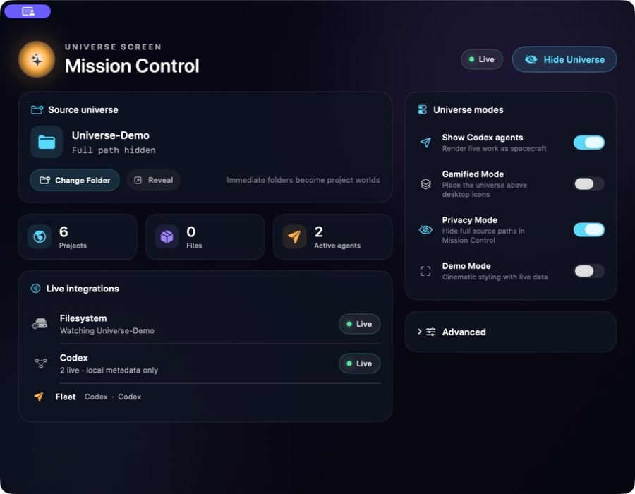
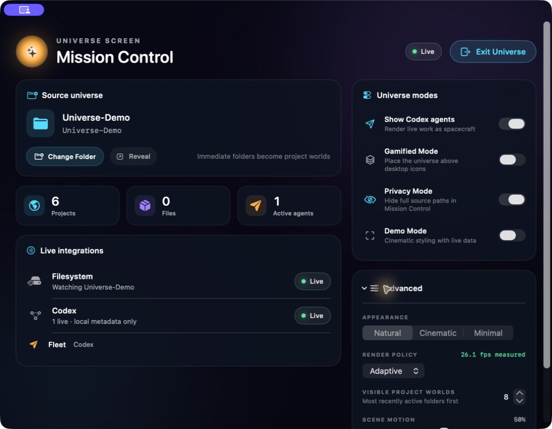
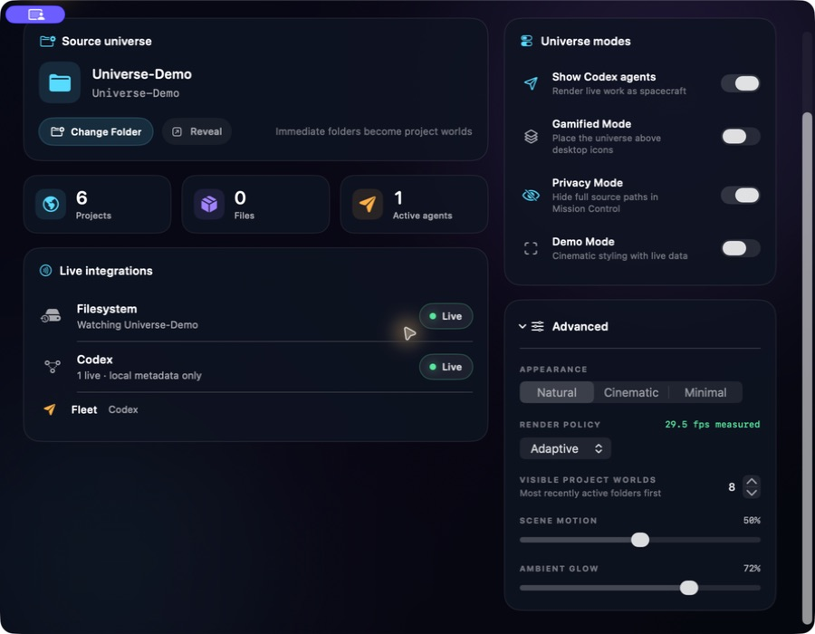
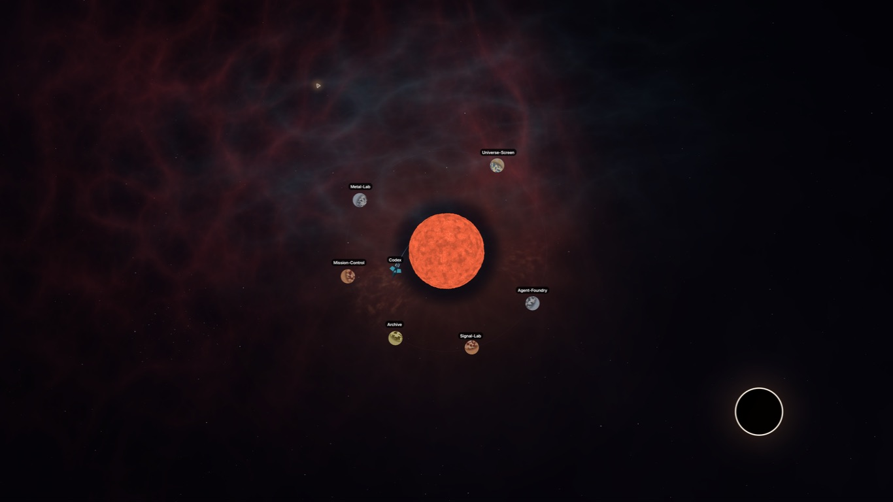
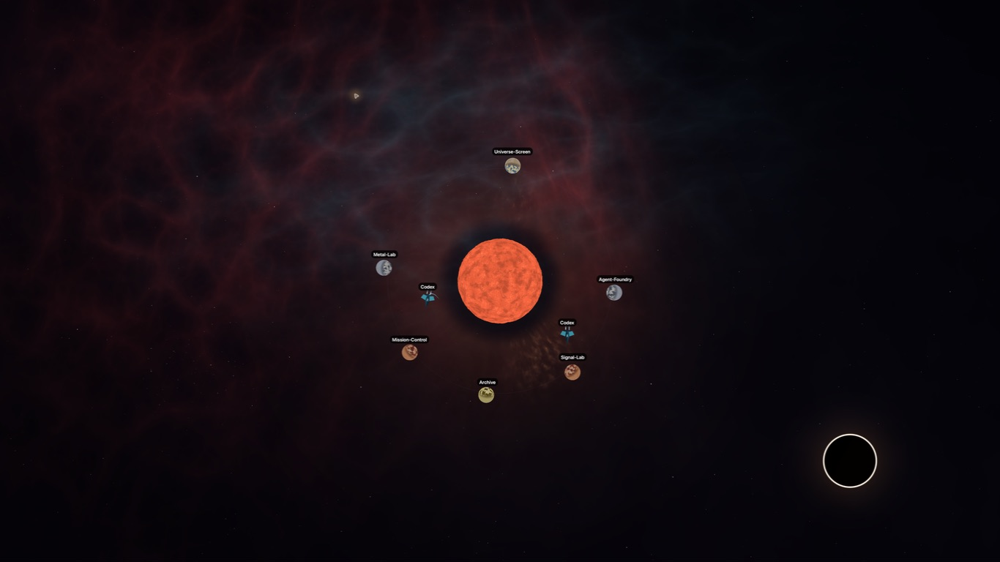

# Portfolio readiness audit

Audit date: July 17, 2026  
Build: local unsigned Debug build, native macOS/Metal  
Demo source: `/Users/Shared/Universe-Demo`

## Outcome

Universe Screen has a strong flagship visual and a legible central metaphor.
The remaining work is mostly evidence and publication packaging rather than a
fundamental redesign. The most important product issue found during the audit—
spacecraft that did not visibly respond to agent activity—was fixed and
recaptured.

## Walkthrough

1. **Mission Control — healthy.** The first screen establishes the source,
   universe modes, live integrations, and counts without requiring the user to
   understand the renderer.

   

   The primary action now says “Hide Universe” rather than “Exit Universe,”
   matching the actual behavior. Privacy Mode says “Full path hidden” instead
   of repeating the source basename as if it were a redacted path.

2. **Advanced controls — healthy with minor density.** Appearance, performance,
   motion, glow, world limit, and measured frame rate are grouped behind
   disclosure rather than competing with the primary setup.

   

   The panel requires scrolling at the default window size. That is acceptable
   for advanced settings, though the on-state color of macOS switches is less
   prominent in a still capture than the cyan feature icons.

3. **Lower settings and evidence — healthy.** The controls expose an actual
   measured frame rate and make the visible-world cap explicit.

   

   During the audit, the adaptive target stayed near 29–30 fps. That is a
   measured observation on one Mac, not a general benchmark.

4. **Live universe — visually strong.** A curated source produces six
   public-safe worlds around the central star, with a black hole and stable
   labels.

   

   The scene has no first-run legend, so a portfolio caption or short demo must
   explain the mapping. The universe interaction is currently mouse-only.

5. **Live fleet — fixed and verified.** After a cold restart, the app recovered
   two active Codex sessions from local metadata and rendered two named ships.
   The ships changed position between successive captures and now use
   state-specific paths and trails. Recognized working-directory and file
   targets also retarget the flight path inside the corresponding project
   world's local space.

   

   

   A restart-specific monitoring bug was also fixed: long active rollout files
   can now recover an active lifecycle from fresh allowlisted events even when
   the original start record is outside the bounded file tail.

## Findings by severity

### Resolved

- Static/decorative agent ships did not satisfy the central live-agent promise.
- Long active Codex sessions could disappear after an app restart.
- “Exit Universe” implied quitting rather than hiding the wallpaper window.
- Privacy Mode repeated a basename where users expected a redacted path.
- Filesystem status could say Live even if the FSEvents stream failed to start.
- The project lacked a test target and reproducible automated checks.

### Important before public release

- Record one uncut causal demo that shows a real folder becoming a planet and a
  real task becoming a moving ship.
- Complete source publication, license, signing, and permissions review.
- Add keyboard and assistive-technology paths for core universe interactions,
  or disclose the mouse-only limitation prominently.

### Nice to improve

- Add a concise first-run legend for star, planet, asteroid, black hole, and
  ship meanings.
- Make activity states easier to distinguish in a still image, perhaps with a
  small optional legend in Mission Control.
- Validate the metaphor with people other than the creator before making broad
  productivity claims.

## Verification

The Debug scheme builds successfully. Seven tests pass:

1. deterministic stable hashing;
2. docked ship movement during tool activity;
3. visible activity-transition cue reset;
4. file-space retargeting when the active file changes;
5. structured location extraction plus oversized active rollout recovery;
6. privacy-mode source-path redaction;
7. visible-world limit clamping.

Screenshots verify visual hierarchy, public-safe labels, live integration
status, and successive fleet positions. They do not establish full
accessibility, distribution readiness, or performance across other Macs.
