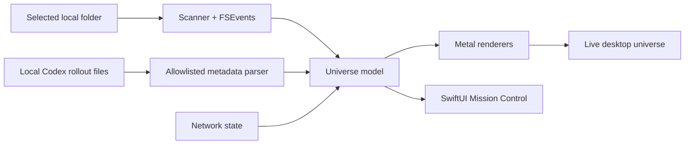

# Universe Screen — Sol Edition

> A native macOS prototype that turns a real workspace into a live solar
> system: project folders become worlds, files become asteroids, and active
> Codex sessions become spacecraft whose motion reflects what the agents are
> doing.

## Status

Universe Screen is a working, self-initiated prototype—not a shipped product.
The Sol Edition is a native Swift, SwiftUI, and Metal rebuild of an earlier
macOS experiment. It currently runs locally, watches a selected folder in real
time, and visualizes privacy-filtered local Codex activity.

The primary user so far is Josiah. A broader audience of people managing many
projects or parallel agents is plausible, but has not been validated through
external user testing.

## Why build this?

Desktop files are usually presented as a list or grid. That is efficient, but
it does not make a changing body of work feel spatial, alive, or easy to
remember.

Josiah wanted to see whether the Mac desktop could feel as tactile and
manipulable as a website. The original idea was a filesystem you could
understand at a glance:

- the browser or network becomes the central star;
- project folders become distinct planets;
- files become smaller orbiting bodies;
- Trash becomes a black hole;
- active AI work becomes a fleet moving among the projects.

Success for this prototype means the metaphor is not merely decorative. A
visible change should be caused by a real local event, and the relationship
should remain legible without exposing the content of private work.

## The experience

Mission Control lets the user choose the source folder, verify the live data
connections, and tune the presentation without editing code.

The universe then maps the immediate contents of that folder into a procedural
scene. A folder can be opened as a focused world; a file asteroid can open the
real file. Filesystem changes arrive through FSEvents.

Codex sessions are shown as spacecraft. A ship launches toward the project that
contains its working directory. When a recognized local tool reports a new
working directory or file target, the ship flies to a deterministic location
around that project world. Deeper file locations sit farther and higher in the
world's local space; a visible top-level file can receive the ship directly. If
no visible project safely matches, the ship stays in a neutral orbit rather
than implying a false association.

Ship behavior follows a coarse activity signal:

| Agent signal | Visible behavior |
| --- | --- |
| Starting | Launches from the central star |
| Thinking | Slow local orbit |
| Using a tool | Fast figure-eight with a live trail |
| Communicating | Wider relay loop |
| Working | Steady project patrol |
| Waiting | Quiet hover |
| Finished | Decaying celebration loop |
| Interrupted | Short unstable jitter and failure tint |

The animation contains no prompt text, commands, tool names, arguments, patches,
or tool output.

## How it works

The app is organized into four practical layers:

1. **Local inputs.** A folder scanner and FSEvents watcher read the selected
   workspace. A bounded incremental tailer reads local Codex rollout files.
2. **Privacy boundary.** The Codex parser retains only identity, parent
   relationship, lifecycle, timestamps, coarse activity category, generated
   display name, workspace, and one sanitized filesystem location. Structured
   local-tool fields are inspected transiently; raw commands, arguments, and
   patch bodies are discarded.
3. **Universe model.** Stable hashes keep worlds and ships visually consistent.
   Path-component matching associates an agent with the most specific visible
   project, while unmatched work remains in neutral orbit.
4. **Rendering and control.** Metal renders procedural planets, the star,
   background, black hole, spacecraft, trails, and labels. SwiftUI provides the
   control surface and measured status.

## Hard decisions

### Make the agent motion truthful

The first fleet implementation could display a spacecraft without giving it a
meaningful live behavior. That failed the core promise. The revised model
separates lifecycle from activity, resets a visible cue when activity changes,
advances the ship every render frame, and retargets the flight path when the
agent's sanitized file-space location changes.

A cold-launch bug also appeared during portfolio capture: a very large,
still-active Codex rollout could have its original `task_started` record outside
the bounded tail. Fresh allowlisted non-terminal activity now recovers the
active lifecycle, while a later terminal event still wins.

### Preserve privacy without pretending labels are anonymous

Privacy Mode hides the full selected path in Mission Control, and the Codex
parser never retains authored content. Planet labels are still real folder
basenames. Public captures therefore use a curated synthetic workspace rather
than claiming that one toggle makes every scene safe to publish.

### Prefer honest ambiguity to invented certainty

Working-directory matching uses path components rather than raw string
prefixes. When a current agent does not belong to a displayed project, its ship
orbits the star. It does not quietly attach itself to a visually convenient
world.

### Keep the renderer responsive

The app performs filesystem scans away from the main thread, uses a quick scan
before deeper size calculation, updates agent buffers each frame, and offers
30- and 60-fps render policies. A single renderer currently owns the primary
display to avoid double-ticking shared mutable state.

## Evidence

Demonstrated on the development Mac on July 17, 2026:

- a selected real folder produced six labeled project worlds;
- FSEvents reported the selected source as live;
- the local Codex monitor recovered two active sessions after a full app
  restart;
- two spacecraft rendered from that live metadata and changed position across
  successive captures;
- the adaptive render policy measured approximately 29–30 fps during the audit;
- seven automated tests passed, including docked-ship motion, file-space
  retargeting, activity-transition cues, privacy redaction, world-limit
  clamping, deterministic hashing, and structured location extraction during
  recovery of an oversized active rollout.

These are prototype and engineering checks. They are not evidence of adoption,
product-market fit, accessibility conformance, or improved productivity.

## Contribution and attribution

Josiah originated the desktop-as-universe direction, the tactile filesystem
metaphor, the decision to revisit the earlier prototype, and the acceptance
criteria for what should feel alive and truthful. He selected the behavior,
tested the result on his Mac, and directed the portfolio framing.

GPT-5.6 Sol Ultra through Codex materially generated and iterated the native
Swift, SwiftUI, Metal, test, documentation, and audit implementation under
Josiah's review. The earlier prototype also contained substantial AI-written
code. This is intentionally presented as an AI-assisted collaboration, not as
code Josiah claims to have written alone.

The implementation uses Apple platform frameworks and no third-party visual
assets in the captured scene.

## What changed from the earlier prototype

The earlier version proved that the metaphor could run at roughly 30–60 fps,
but it remained buggy and difficult to evolve. The Sol Edition turned the idea
into a more explicit native system:

- a selectable source instead of a hard-coded universe;
- live filesystem updates;
- a dedicated Mission Control dashboard;
- a metadata-only live agent fleet;
- state-driven spacecraft motion;
- public-demo privacy controls;
- automated tests and a reproducible XcodeGen build.

## Limits and risks

- The app is local and unsandboxed; distribution, signing, and permissions have
  not been productized.
- Only the primary display currently receives a universe renderer.
- The universe itself is mouse-driven and has not received a full keyboard,
  VoiceOver, reduced-motion, contrast, or assistive-technology audit.
- Folder and agent counts are deliberately capped for visual and performance
  reasons.
- Privacy Mode redacts the displayed source path, but real basenames remain
  visible and local Codex metadata monitoring continues.
- No external user study, retention metric, revenue, or broad performance
  benchmark exists.
- The source is still undergoing a publication and licensing review. The story
  and curated captures are safer to share than the full repository today.

## The strongest proof

The strongest demo is an uncut cause-and-effect sequence: select a curated
folder, create a project folder, watch its planet appear, start a real Codex
task inside it, and watch the corresponding ship launch and change behavior as
the agent thinks, uses tools, communicates, and finishes.

The current short capture proves live fleet motion. The full causal recording
remains the final portfolio asset to produce.
