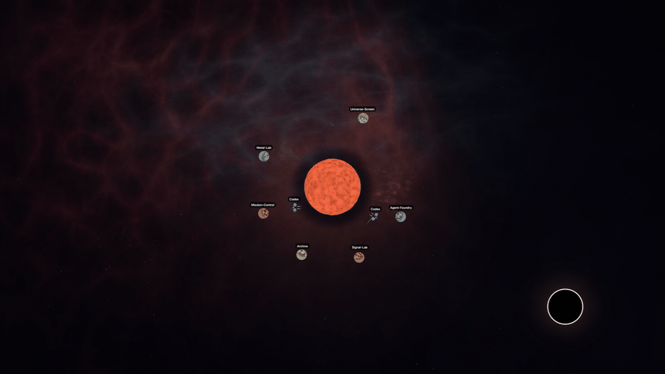

# Universe Screen — Sol Edition

Your real projects become worlds. Your live Codex agents become spacecraft working among them.



This is a native macOS/Metal rebuild of the original Universe Screen prototype. It keeps the tactile filesystem metaphor—folders as procedural planets, files as asteroids, the internet as a star, and Trash as a black hole—then adds a configurable Mission Control dashboard and a live Codex fleet.

## What works

- Choose any source folder without restarting the app.
- Immediate subfolders become labeled procedural planets; files become asteroids.
- FSEvents updates the scene when folders or files are created, renamed, or removed.
- A native SwiftUI Mission Control window shows live filesystem/Codex status and counts.
- Privacy-filtered local Codex metadata drives named spacecraft, file-space destinations, launch paths, activity-specific movement, working/waiting/completed colors, engines, and packet trails.
- Ships visibly respond to coarse live activity: thinking, tool use, communication, steady work, waiting, completion, and interruption.
- A recognized tool working directory or file target retargets the ship inside the corresponding project world; unmatched agents remain honestly in neutral orbit.
- Dashboard controls include source folder, visible-world limit, universe visibility, agent visibility, Gamified Mode, path privacy, appearance, motion, glow, render policy, and measured frame rate.
- Double-click a planet to inspect its real contents; click a file asteroid to open the real file.

## Privacy boundary

The Codex monitor retains only session identity, parent relationship, lifecycle,
timestamps, coarse activity category, generated display name, workspace, and
one sanitized filesystem location. It can inspect structured local-tool fields
long enough to extract that location, then discards the raw arguments. It does
**not** retain or display prompts, messages, reasoning, commands, raw tool
arguments, patches, or tool output.

Privacy Mode hides full source paths in Mission Control. Planet labels are real folder basenames, so select a curated source folder before recording or sharing a public demo.

Demo Mode is a stricter boundary: it pauses live filesystem and local Codex
monitoring, then renders only the validated, checked-in synthetic scene at
`Resources/Demo/sample-manifest.json` with a fixed procedural seed. Mission
Control explicitly identifies both feeds as synthetic while that mode is on.

## Build

Requirements: macOS 26, Xcode 26, the Xcode Metal toolchain, and XcodeGen.

```sh
brew install xcodegen
xcodegen generate
DEVELOPER_DIR=/Applications/Xcode.app/Contents/Developer \
  xcodebuild -project GravityWallpaper.xcodeproj \
  -scheme GravityWallpaper -configuration Release build
```

For a local unsigned debug build:

```sh
DEVELOPER_DIR=/Applications/Xcode.app/Contents/Developer \
  xcodebuild -project GravityWallpaper.xcodeproj \
  -scheme GravityWallpaper -configuration Debug \
  -derivedDataPath /tmp/universe-screen-sol-derived \
  CODE_SIGNING_ALLOWED=NO ENABLE_DEBUG_DYLIB=NO build
```

The product is `Universe Screen.app`. It runs as a menu-bar accessory and opens Mission Control at launch.

## Test

```sh
DEVELOPER_DIR=/Applications/Xcode.app/Contents/Developer \
  xcodebuild -project GravityWallpaper.xcodeproj \
  -scheme GravityWallpaper -configuration Debug \
  -derivedDataPath /tmp/universe-screen-sol-derived \
  CODE_SIGNING_ALLOWED=NO ENABLE_DEBUG_DYLIB=NO test
```

The current suite covers deterministic layout identity, activity-driven ship
motion, file-space retargeting, structured location extraction, transition
cues, long-session recovery after a cold launch, dashboard privacy redaction,
visible-world limits, synthetic-manifest validation, deterministic demo scene
construction, bundled demo resources, and the 15-second 1080p export contract.

## Portfolio record

- [Case study](Portfolio/CASE_STUDY.md)
- [Portfolio readiness audit](Portfolio/AUDIT.md)
- [42-second demo plan](DEMO.md)
- [Commercial output and provenance boundary](COMMERCIAL_OUTPUT.md)

This is a working local prototype, not a shipped product. It has not completed
distribution signing, a full accessibility audit, or external user validation.
The source is published for inspection, but no open-source license has been
selected; reuse rights are therefore not granted by default.

The long-form public record is available at
[josiahwilson.me/projects/universe-screen](https://josiahwilson.me/projects/universe-screen/).

## Demo principle

The strongest proof is uncut cause and effect: choose a safe real workspace, create a folder while Mission Control is visible, watch the project count change and the planet arrive, then start a real Codex task in one of those projects and watch the corresponding ship launch.

See [DEMO.md](DEMO.md) for the compact recording plan and claim checklist.

The sellable proof is narrower than the live-product demo: a silent 15-second
1920x1080 H.264 loop made only from Demo Mode using the checked-in export
preset. It does not include source, an app binary, live telemetry, or the
separate Codex runtime-injection variant.
